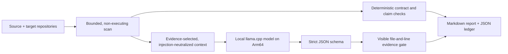

# ProofEdge

**Evidence before confidence. Private migration assurance on Arm64.**

[Live demo](https://proofedge-arm64.liu891855.chatgpt.site) ·
[Challenge video](https://youtu.be/iuY49KZkrSs) ·
[v1.0.0 release](https://github.com/agentic-build-lab/proofedge-arm64/releases/tag/v1.0.0) ·
[Native Arm evidence](BENCHMARKS.md) ·
[Evaluation protocol](EVALUATION.md) ·
[MIT license](LICENSE)

ProofEdge is a local-first engineering agent for reviewing software migrations. It compares a
source implementation with its target, finds contract and test-coverage risks, asks a compact
local model for differential-test proposals, and publishes only proposals whose file-and-line
evidence survives a deterministic gate.

The project targets the **Cloud AI** track of the Arm Create: AI Optimization Challenge. Its local
inference path uses `llama.cpp`, a Q4_0 Qwen2.5-Coder 1.5B model, and optional KleidiAI kernels on
CPU-only Arm64. No hosted model API or paid service is required.

## Why it exists

Code translation can look convincing while silently changing rounding, error behavior, response
codes, or test coverage. ProofEdge does not claim to prove semantic equivalence. It creates an
auditable review boundary:

1. What public contracts existed before and after the migration?
2. Which migration claims have pinned evidence?
3. Which tests could distinguish the two behaviors?
4. Which model suggestions are unsupported and must not be published?

## How it works



- Repository code is treated as hostile data and is never executed by the analyzer.
- The scanner prunes links, junctions, ignored trees, binary files, oversized files, and excessive
  depth or entry counts before model context is constructed.
- Repository instruction-like text is replaced by a typed hash placeholder in model-visible
  context.
- Model output has a closed schema. Unknown fields, bad types, invalid enums, missing tests, and
  nonexistent or invisible evidence references are rejected.
- If every model proposal fails the gate, the CLI emits an explicit `deterministic-fallback`
  report and exits with status 2. It never presents fallback output as model success.

## Measured status

Every figure below is from committed raw evidence or a linked GitHub Actions artifact. Negative
results are retained.

| Layer | Result | Scope |
| --- | --- | --- |
| Deterministic quality | 2/2 cases; 5/5 expected categories; unsupported-claim recall 1.00; false unsupported rate 0.00 | Frozen synthetic controls; not local-model accuracy |
| Native deterministic function path | 30/30 task passes; warm p50 2.397 ms; warm p95 2.539 ms; cold 3.034 ms; peak RSS 24,516 KiB | Latest main commit on native `aarch64` Neoverse N2; direct static evaluation, excluding CLI startup and report I/O |
| Confirmed same-model runtime A/B | pp1024 96.738 → 97.280 tok/s (**+0.560%**); tg128 35.244 → 36.753 tok/s (**+4.281%**) | Independent ABBA confirmation of the preselected profile; Qwen Q4_0, same native Neoverse N2 VM and model bytes |
| Frozen product requests | Mean model compute 13.367 → 13.118 s (**−1.869%**); both responses byte-identical | Two descriptive quality-gate requests inside `llama-server`; not full CLI end-to-end latency or a repeated-trial claim |
| Frozen local-model gate | Baseline and KleidiAI each passed 2/2 cases; schema, raw-reference validity, and risk coverage all 1.00; canary leakage and fallback both 0 | Optimized context on both runtimes; raw responses and ledgers retained |

The first exploratory profile remains published as **mixed/negative** (+0.532% prefill,
−0.697% decode). A separately frozen tuning sweep selected a new profile, and independent run
[`30830782393`](https://github.com/agentic-build-lab/proofedge-arm64/actions/runs/30830782393)
confirmed the figures above while both local-model quality gates passed. These are runtime
throughput results, not energy claims. The same run also captured server timings for two frozen
ProofEdge quality requests: KleidiAI reduced aggregate model compute by 1.869% while preserving
the exact response hashes. This is descriptive product-task evidence, not full CLI latency or a
repeated-trial estimate. See the
[benchmark protocol and qualifications](BENCHMARKS.md).

## Quick start: credential-free deterministic path

Python 3.11 or newer is required.

```bash
python -m venv .venv
source .venv/bin/activate
python -m pip install -e .

proofedge analyze \
  --source evaluation/cases/python-refund-v2/source \
  --target evaluation/cases/python-refund-v2/target \
  --manifest evaluation/cases/python-refund-v2/manifest.json \
  --output reports/python-refund-v2
```

On Windows PowerShell, activate with `.venv\Scripts\Activate.ps1`. The command writes
`report.md` and `evidence-ledger.json` under the output directory.

Run the frozen deterministic quality set:

```bash
proofedge evaluate \
  --cases evaluation/cases \
  --output evaluation/results/deterministic.json
```

## Local-model path

Start an OpenAI-compatible `llama-server` on loopback with the pinned model, then run:

```bash
proofedge analyze \
  --source evaluation/cases/python-refund-v2/source \
  --target evaluation/cases/python-refund-v2/target \
  --manifest evaluation/cases/python-refund-v2/manifest.json \
  --engine llama.cpp \
  --endpoint http://127.0.0.1:8080 \
  --profile optimized \
  --output reports/python-refund-v2-local
```

Only literal loopback endpoints are accepted after DNS resolution. Credentials, URL query or
fragment data, proxies, redirects, and responses above 1 MiB are rejected. The client disables
prompt caching for a clean evidence path.

Run the separate frozen model gate with:

```bash
proofedge evaluate-model \
  --cases evaluation/cases \
  --endpoint http://127.0.0.1:8080 \
  --profile optimized \
  --output evaluation/results/local-model.json
```

## Reproduce development and Arm evidence

The development environment is hash-locked:

```bash
python -m pip install --require-hashes -r requirements-dev.lock
python -m pip install --no-build-isolation --no-deps -e .
ruff check .
ruff format --check .
pytest --cov=proofedge --cov-fail-under=75
```

The native workflows are manual because they download a pinned 1.07 GB public model and compile
one or two `llama.cpp` builds. They run on GitHub's native `ubuntu-24.04-arm` runner, never QEMU:

- `Native Arm64 llama.cpp A-B benchmark` — same-host ABBA plus the frozen model-quality matrix.
- `Native Arm64 llama.cpp tuning exploration` — predeclared thread, chunk, batch, and depth sweep.
- `Native Arm64 evidence` — lightweight deterministic regression evidence on every push.

All GitHub Actions are pinned by full commit SHA. Model, runtime, config, binary, environment, raw
output, and artifact hashes are retained. See [reproducibility](docs/REPRODUCIBILITY.md),
[optimization](docs/OPTIMIZATION.md), and [evaluation](docs/EVALUATION.md).

## Security and limitations

Read [SECURITY.md](SECURITY.md) and the [threat model](THREAT_MODEL.md) before analyzing
untrusted repositories. Important limits:

- Static matching and model proposals are risk signals, not proof of equivalence.
- Cross-language renames need explicit `contract_aliases` in the manifest.
- No energy claim is made because the cloud runner exposes no calibrated power telemetry.
- The current corpus is intentionally small and challenge-created; it demonstrates falsifiable
  gates, not broad language coverage.
- The public demo replays a frozen fixture. It does not upload code, run a model, or execute tests.

## Licenses

ProofEdge is [MIT licensed](LICENSE). The pinned Qwen model is Apache-2.0, `llama.cpp` is MIT, and
KleidiAI is distributed under the license files in its upstream `LICENSES` directory. No model or
third-party runtime source is redistributed in this repository. See
[models and licenses](docs/MODELS_AND_LICENSES.md) and [third-party notices](THIRD_PARTY_NOTICES.md).
